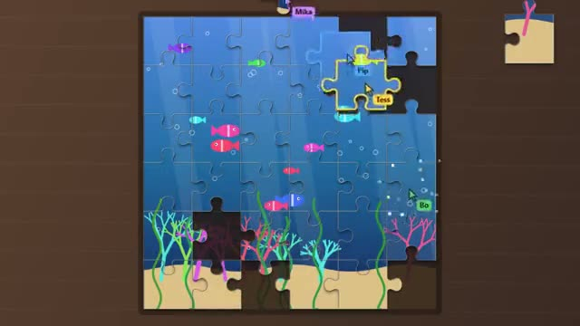

# Jigsaw Jam

Build a fresh jigsaw together, piece by piece. A multiplayer starter game from [Multiplayer Agent](https://multiplayeragent.com): 2D, co-op, 1–8 players, with helper bots that fill empty seats.

## How it plays

Every round paints a new picture and cuts it into 36 pieces. Drag pieces into the frame and they snap into place when they're close. A piece you're holding is yours until you let go, so nobody can snatch it. Finish fast to get on the board.

**Controls:** Drag pieces with the mouse or a finger; drag the table to look around, scroll or pinch to zoom.

## Make it yours in the Game Builder

Open the [Game Builder](https://multiplayeragent.com), choose **Start from a starter game** and pick Jigsaw Jam. It opens as version 1 in your studio, ready to play and publish. Then ask for changes, for example:

- Use 64 smaller pieces for a harder puzzle
- Paint space scenes with planets and rockets
- Let pieces turn, and right-click to rotate them

## Run it yourself

1. Get a free publishable key (`pk_…`) at [multiplayeragent.com](https://multiplayeragent.com).
2. In `index.html`, put it in place of `pk_REPLACE_ME` in the `MP_CONNECT` block.
3. Open `index.html` in a browser. No build step and no server needed.

Without a key it still runs, offline with helper bots.

## How it is built

- One `index.html`. The comment at the top of the script maps the code and explains the multiplayer.
- The pictures are painted in code (`paintPicture`: rolling hills, a city at dusk or a coral reef) from a seed, and the pieces are cut with the same seed, so a new puzzle needs no image files. Change `CONFIG.cols` and `CONFIG.rows` for more or fewer pieces.
- **Host-run rules:** The host's browser decides who holds each piece and when one snaps; if it leaves, the next player takes over.
- **Bots:** Helper bots fit pieces alongside you when the room is quiet.
- **Leaderboard:** The fastest finished puzzle.
- **Live sync:** Everyone's cursor and the piece in their hand move live for the whole table.
- `?attract` runs it offline with bots only. The preview video is recorded from it.

## License

MIT.
